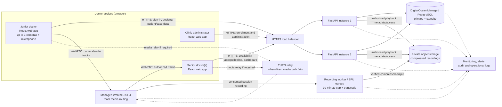
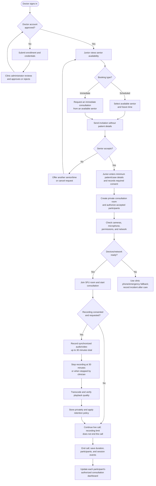

# Dentovision High-Level Design

## 1. Purpose and scope

This document describes the proposed high-level design for the first six-month pilot. It complements [BRD.md](./BRD.md); it is not a claim that these production features are already implemented.

The pilot targets:

- Four simultaneous private consultations.
- Up to three junior-doctor camera feeds per consultation.
- One junior doctor and one or more invited senior doctors per consultation.
- Scheduled bookings and immediate consultation requests.
- Doctor enrollment, availability, consultation history, and dashboards.
- Patient/case details entered before the call, subject to clinic policy.
- Optional recording with a 30-minute maximum per consultation, compression, and restricted playback.

## 2. Design principles

1. Keep application data, live media, and video files on separate services.
2. Use a managed WebRTC Selective Forwarding Unit (SFU) for the pilot rather than custom media routing.
3. Keep patient information private to assigned participants and authorized clinic administrators.
4. A recording time limit must not terminate an active clinical call.
5. A call or AI failure must not prevent clinicians from using the clinic's approved phone/emergency process.
6. Start with a small, measurable pilot and scale from observed usage and tested failure modes.

## 3. Proposed pilot architecture

### Component responsibilities

| Component | Responsibility |
|---|---|
| React web app | Doctor sign-in, enrollment status, availability, booking, patient/case details, call controls, notes, dashboards, and authorized playback. |
| FastAPI application | Authentication and authorization, doctor enrollment, availability, scheduling, consultation state, consent metadata, dashboard queries, audit events, and media-service token issuance. |
| PostgreSQL | Doctor and clinic records, roles, availability, bookings, participant membership, minimum patient/case details, consent records, notes, audit metadata, and recording indexes. Store no video blobs here. |
| WebRTC SFU | Routes camera and audio tracks between authorized room participants. It handles real-time media, not patient scheduling or clinical records. |
| TURN | Relays WebRTC traffic when clinic/mobile network restrictions prevent a direct media route. |
| Recording/egress worker | Captures consented media, enforces the 30-minute recording limit, transcodes after capture, validates output, and marks the recording ready or failed. |
| Private object storage | Stores encrypted recording files; access is granted only after application authorization, using short-lived access URLs or a controlled streaming endpoint. |
| Monitoring and audit | Collects service health, call quality, errors, access events, and alert signals. Do not log video, audio, credentials, or unnecessary patient details. |

## 4. Main data objects

| Object | Key information |
|---|---|
| Doctor | Identity, role, clinic membership, enrollment/approval status, credentials reference, and account status. |
| Availability | Working hours, time off, current status (available/busy/unavailable), and next available period where known. |
| Consultation | Unique ID, status, scheduled/actual times, junior doctor, invited/accepted seniors, clinic, and approved patient/case reference. |
| Consent | Consent status, scope (including recording), captured by, timestamp, and any withdrawal/action history required by policy. |
| Session event | Join/leave, participant changes, connection/recording status, end reason, and audit information. |
| Recording | Consultation ID, camera/audio track labels, duration, processing state, storage key, size, checksum, retention/deletion date, and access history. |
| Note | Consultation ID, author, draft/signed status, content, timestamps, and amendment history. |

Patient details should be minimized according to clinic policy. Notifications should contain a consultation reference and action, not patient details.

## 5. Consultation and booking workflow diagram

## 6. Key behavior and access rules

### Enrollment and availability

- A doctor submits enrollment information; an authorized clinic administrator approves or rejects it.
- Only approved, active doctors can set availability or book/join consultations.
- Availability indicates whether a senior can accept a call; it does not reveal private calendar details.
- Booking confirmation is transactional: only one booking can claim a doctor's slot. Immediate requests require explicit senior acceptance.
- On acceptance, mark the senior busy for the consultation. On cancellation or end, restore availability according to the doctor's schedule/status.

### Patient-linked private consultation

- The junior enters the minimum case details required by clinic policy before creating the call.
- Create the room with an unguessable identifier and short-lived, participant-specific join credentials.
- Check the user's role, clinic, consultation membership, and consent on every protected API action.
- Do not expose patient information in doctor availability, push/email notifications, public URLs, or ordinary operational logs.
- Record access to patient details, notes, and recordings in an audit trail.

### Call, recording, and playback

- Audio/video travels through the SFU; it does not pass through ordinary FastAPI request handlers.
- Use TURN when required by network conditions. Monitor packet loss, jitter, reconnects, and participant state.
- Recording starts only after required consent. Show a clear recording indicator and status to all participants.
- Stop the recording at 30 minutes total for that consultation; keep the live call available.
- Transcode to a tested H.264 profile/bitrate after capture. Keep the original temporarily until integrity and clinical playback quality checks pass.
- Mark processing errors explicitly; do not report a failed or unverified recording as ready.
- Authorize playback in the API before granting short-lived access to private object storage.

### Dashboard

- A doctor sees consultations they participated in, role, date/time, other participants, authorized patient/case reference, duration, and total session hours.
- Senior doctors see their own attended consultations as well as any explicitly authorized clinic-level view.
- Dashboard totals are based on completed session metadata, not video-file duration.
- Access to patient/case references and recording playback is separately authorized and audited.

## 7. Deployment and availability

For the six-month pilot, use the initial sizing and services described in [BRD.md](./BRD.md):

- Two small FastAPI instances behind a load balancer; keep application state in PostgreSQL or another shared service, not instance memory.
- DigitalOcean Managed PostgreSQL with a primary and at least one standby, private networking, SSL, backups, and point-in-time recovery.
- A managed SFU sized for four concurrent rooms and twelve junior camera publishers, with tested TURN connectivity.
- Private S3-compatible object storage for recordings; do not store video on application-instance disks.
- Central service/call monitoring, storage/database alerts, tested database restore, and a documented clinic phone fallback.

This reduces application and database single points of failure, but does not promise zero downtime. SFU availability, clinic internet, storage, and provider incidents remain dependencies. Define acceptable recovery targets with the clinic and test failover and call reconnection before real patient use.

## 8. Failure handling

| Failure | Expected behavior |
|---|---|
| API instance unavailable | Load balancer routes new API requests to the healthy instance. Existing media can continue through the SFU if the provider supports it. |
| Database failover | API reconnects with bounded retry and reports an explicit error if unavailable. Do not create success-shaped bookings or lose consent state. |
| Senior declines or becomes unavailable | Do not create a confirmed booking. Offer another available senior/time or cancel and notify the junior without patient details. |
| Camera or media connection fails | Show which feed failed, offer retry/low-bandwidth options, and preserve audio where clinically suitable. |
| SFU/provider outage | Show service issue and direct users to the clinic-approved phone/emergency workflow. Do not imply the consultation is active if it is not. |
| Recording/transcoding failure | Keep the call separate from recording processing; show recording failure, preserve recoverable source chunks where possible, and alert support. |
| Storage or playback unavailable | Do not claim recording is saved/available. Keep metadata and error status, alert support, and follow retention/retry policy. |

## 9. Pilot acceptance checks

- Test doctor enrollment, approval, role restrictions, availability changes, booking acceptance/decline, conflicts, cancellation, and rescheduling.
- Verify patient details cannot be seen by uninvited doctors, in notifications, or from guessed room IDs.
- Run four simultaneous rooms with three camera feeds per junior and the required senior viewers on actual target networks.
- Test recording consent, the 25-minute warning, the 30-minute recording stop, continued live call, compression, verification, authorized playback, and deletion.
- Test API instance restart, database failover/reconnect, camera disconnect/reconnect, and the clinical phone fallback.
- Confirm dashboards show only authorized consultations, participants, duration, and totals.
- Complete privacy/security, clinical safety, retention, and operational reviews before real patient data is used.
